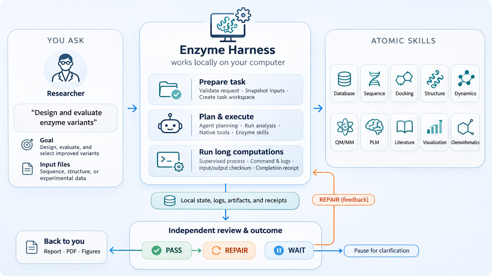
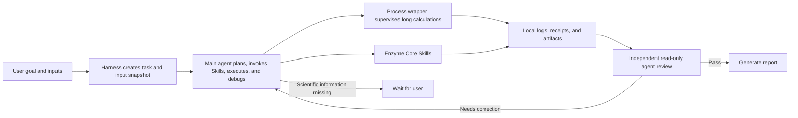
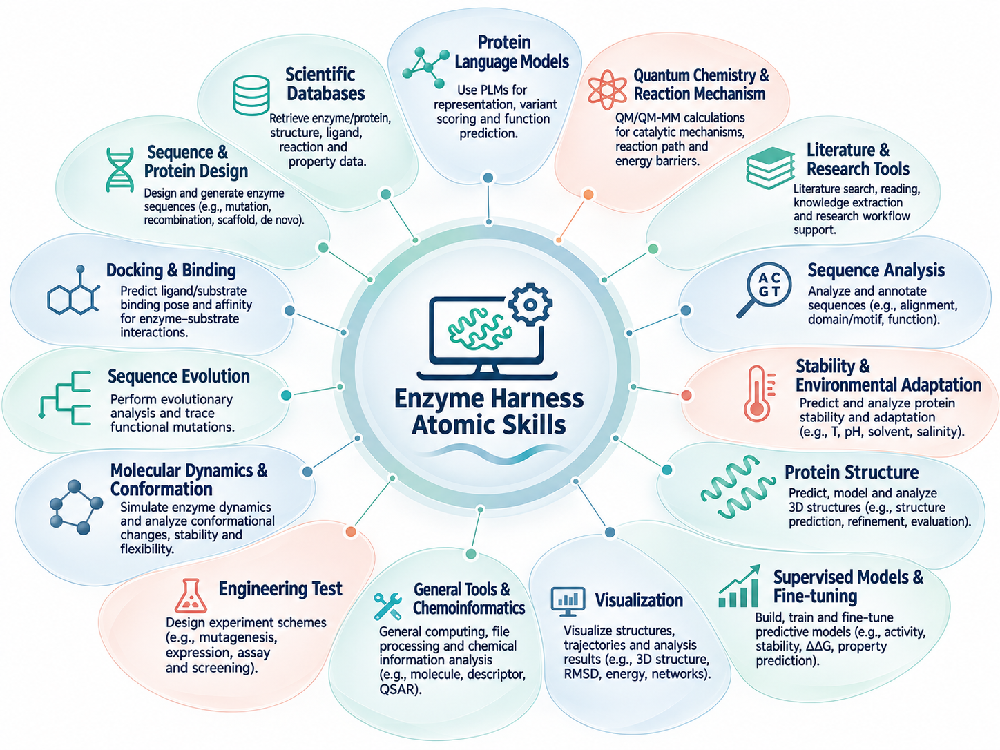

[English] | [简体中文](README.zh-CN.md)

# Enzyme Core and Harness

**A local, composable Skill toolkit for enzyme and protein research, with a selectable native-agent harness (Codex CLI or DeepSeek Harness) for long-running tasks.**

Enzyme Core packages scientific workflows as discoverable, documented, checkable, and callable atomic Skills. Enzyme Harness runs native agent sessions around those Skills and handles task workspaces, long-process supervision, durable evidence, recovery, independent review, and local reports. The agent is chosen per setup or per task: Codex CLI for GPT-family models, or DeepSeek Harness (`dsh`) for DeepSeek models and configurable provider routes. Researchers can invoke a single Skill directly or give the Harness a short natural-language goal for the agent to plan and carry out a multi-step workflow.

> A registered Skill means that the repository provides workflow instructions or an execution entry point. It does not mean the required software, model weights, databases, GPU, credentials, or scientific inputs are installed, nor that a result has been scientifically validated.

## At a glance

- **95 catalogued Skills** spanning sequence, structure, protein language models, design, docking, molecular dynamics, quantum chemistry, cheminformatics, databases, research support, and visualization.
- **202 generated operation-interface entries** describing parameters, inputs/outputs, and resource requirements for registered operations.
- **Two Python distributions**: `enzyme-core` provides the Skills; `enzyme-harness` provides agent task execution and local supervision for Codex CLI or `dsh`.
- **Selectable agent runtime**: Codex CLI (GPT-family models) or DeepSeek Harness (`dsh`, DeepSeek and configurable provider routes), chosen per setup or per request with one shared task, review, and report pipeline.
- **Local-first evidence**: task state, input snapshots, command records, process receipts, and results are kept under the configured local task root.
- **Configure per workflow**: the base install is intentionally light; scientific software, model weights, GPUs, external services, and database access are set up as needed by each Skill.

## Architecture and workflow



A typical task proceeds as follows:

1. The user submits a goal and input files. Harness validates the request and snapshots inputs into a task workspace.
2. The main agent (Codex CLI or `dsh`) reads the request, inputs, and relevant Skills, then plans, invokes Skills, runs analysis, and debugs as needed.
3. Long-running scientific commands can run under a local process wrapper that records the command, process identity, logs, resource measurements, exit status, and output digests.
4. A new, read-only agent session independently reviews the request, execution evidence, artifacts, and conclusions.
5. A passing review produces a local report. Review findings return to the main session for correction; missing scientific information can be returned to the user.
6. On resume, Harness reconciles the agent session, managed processes, and receipts before continuing. Unknown process state is not automatically rerun.



### Responsibilities

| Component | Responsibilities | Does not imply |
|---|---|---|
| **Enzyme Core** | Skill discovery and documentation, dependency checks, execution preparation, local Python/executable invocation, and declared-output checks | It does not choose the research question, install every model, or guarantee a scientific conclusion |
| **Enzyme Harness** | Selectable Codex CLI or `dsh` task session, task workspace and input snapshots, long-process supervision, resume, independent read-only review, and local reports | It is not a hosted job service or laboratory database; Harness `PASS` is not experimental validation |
| **A Skill** | Instructions, interface, and a local workflow for a particular scientific method or tool | Discovery does not guarantee that external dependencies or data are available |

## Skill capabilities



The catalog contains 95 directory entries. `repair-validation` is an engineering repair-validation fixture; the other 94 entries make up the routine scientific and research-support catalog. Expand a category below to see every Skill, a short description, and a direct link to its `SKILL.md`.

| Category | Count | Capability | Examples |
|---|---:|---|---|
| `data` | 31 | Protein, sequence, structure, compound, pathway, genome, and biomedical database retrieval. | `brenda-database`, `chembl-database`, `clinical-trials-database` |
| `design` | 6 | Sequence and structure design, protein generation, PyRosetta design, and integrated rational design. | `ligandmpnn`, `proteinmpnn`, `pyrosetta-pack-design` |
| `docking` | 4 | Enzyme–ligand docking, binding modes, affinity, and selectivity analysis. | `binding-affinity`, `pyrosetta-docking`, `pyrosetta-ligand` |
| `evolution` | 2 | Evolutionary information and mutation data for sequence change and functional adaptation. | `gemme`, `rational-expression-evolution` |
| `md` | 2 | Molecular dynamics workflows for conformational, transport, and dynamic behavior. | `openmm-md`, `rational-transport-dynamics` |
| `plm` | 3 | Protein language model representations, zero-shot scoring, and structure-conditioned scoring. | `esm`, `esmif`, `saprot` |
| `qmmm` | 2 | Enzyme catalysis, quantum chemistry, and reaction-mechanism workflows. | `enzyme-qm-ts`, `rational-chemical-mechanism` |
| `research` | 11 | Literature search, evidence synthesis, hypothesis generation, critical analysis, and peer review. | `hypothesis-generation`, `literature-protein-collector`, `literature-review` |
| `sequence` | 4 | Protein and nucleic-acid retrieval, alignment, similarity search, and annotation. | `glycobiology`, `ncbi-sequence-fetch`, `protein-sequence-msa` |
| `stability` | 2 | Structure scoring, stability factors, and environmental adaptation analysis. | `pyrosetta-scoring`, `rational-stability-environment` |
| `structure` | 8 | Structure prediction, structural search, refinement, and structure manipulation. | `alphafold`, `alphafold-database-fetch-and-analyze`, `boltz` |
| `supervised-finetuning-models` | 2 | Supervised model training and fine-tuning workflows for variant scoring. | `mut-model-supervised-finetuning`, `venusfsfp-supervised-finetuning` |
| `testing` | 1 | An engineering repair-validation fixture; not a routine scientific-analysis Skill. | `repair-validation` |
| `utilities` | 7 | Cheminformatics, report rendering, environment helpers, and workflow utilities. | `html-report-renderer`, `markitdown`, `pyrosetta-parallel` |
| `visualization` | 10 | Protein, molecule, structure, data, and scientific-schematic visualization. | `dna-visualization`, `infographics`, `matplotlib` |

<details>
<summary><strong>Full Skill catalog (95 entries)</strong></summary>

<details>
<summary><strong>data</strong> — 31 Skill(s): Protein, sequence, structure, compound, pathway, genome, and biomedical database retrieval.</summary>

| Skill | Summary |
|---|---|
| [brenda-database](src/enzyme_core/skills/data/brenda-database/SKILL.md) | Access BRENDA enzyme database via SOAP API. Retrieve kinetic parameters (Km, kcat), reaction equations, organism data, and substrate-specific enzyme information for biochemical research and metabolic… |
| [chembl-database](src/enzyme_core/skills/data/chembl-database/SKILL.md) | Query the ChEMBL database for bioactive molecules, drug targets, bioactivity data, approved drugs, and chemical structures. Use when the user asks about compounds, targets, IC50/Ki values, drug mechanisms… |
| [clinical-trials-database](src/enzyme_core/skills/data/clinical-trials-database/SKILL.md) | Query ClinicalTrials.gov via APIv2. Use when you want to search for trials by condition, drug, location, status, or phase; retrieve trial details by NCT ID; check eligibility/inclusion criteria; count… |
| [clinvar-database](src/enzyme_core/skills/data/clinvar-database/SKILL.md) | Use when needing clinical significance, pathogenicity classifications (e.g., Pathogenic, Benign, VUS), clinical evidence rationales, or finding "hard positive" benchmark controls for human genomic variants. |
| [dbsnp-database](src/enzyme_core/skills/data/dbsnp-database/SKILL.md) | Use when you want to look up, map, and search for short genetic variants (SNPs, indels) in NCBI's dbSNP database. Resolves between rsIDs, genomic coordinates in VCF format, and HGVS strings. For an rsID… |
| [embl-ebi-ols](src/enzyme_core/skills/data/embl-ebi-ols/SKILL.md) | Query and search the EMBL-EBI Ontology Lookup Service (OLS) for biomedical ontology terms, definitions, and hierarchies across 250+ ontologies (e.g., GO, DOID, HP). Use when the user asks to search for… |
| [ena-database](src/enzyme_core/skills/data/ena-database/SKILL.md) | Access European Nucleotide Archive via API/FTP. Retrieve DNA/RNA sequences, raw reads (FASTQ), genome assemblies by accession, for genomics and bioinformatics pipelines. Supports multiple formats. |
| [encode-ccres-database](src/enzyme_core/skills/data/encode-ccres-database/SKILL.md) | Query the ENCODE Registry of cis-Regulatory Elements (cCREs) via the SCREEN GraphQL API, or make custom queries to the ENCODE Portal REST API for experiments and files (ChIP-seq peaks, etc.). Use when you… |
| [ensembl-database](src/enzyme_core/skills/data/ensembl-database/SKILL.md) | Query the Ensembl database to resolve gene, transcript, and protein IDs, fetch genomic or protein sequences, retrieve gene structures (exons), and get variant consequence and effect predictions (VEP). Use… |
| [gene-database](src/enzyme_core/skills/data/gene-database/SKILL.md) | Query NCBI Gene via E-utilities/Datasets API. Search by symbol/ID, retrieve gene info (RefSeqs, GO, locations, phenotypes), batch lookups, for gene annotation and functional analysis. |
| [gnomad-database](src/enzyme_core/skills/data/gnomad-database/SKILL.md) | Query the Genome Aggregation Database (gnomAD). Use when determining the rarity or allele frequency of specific genetic variants, retrieving gene constraint metrics (pLI, LOEUF) to assess loss-of-function… |
| [gtex-database](src/enzyme_core/skills/data/gtex-database/SKILL.md) | Use when you want to retrieve quantitative RNA expression data and variant eQTL information from the GTEx (Genotype-Tissue Expression) Project across 54 non-diseased tissue sites. |
| [hmdb-database](src/enzyme_core/skills/data/hmdb-database/SKILL.md) | Access Human Metabolome Database (220K+ metabolites). Search by name/ID/structure, retrieve chemical properties, biomarker data, NMR/MS spectra, pathways, for metabolomics and identification. |
| [human-protein-atlas-database](src/enzyme_core/skills/data/human-protein-atlas-database/SKILL.md) | Use when you want to retrieve semi-quantitative protein expression and spatial localisation data from the Human Protein Atlas (HPA). |
| [interpro-database](src/enzyme_core/skills/data/interpro-database/SKILL.md) | Identify domains, families, and sites in proteins; find all proteins in a family or sharing a domain; explore species distribution for a domain; annotate genomes with protein families and GO terms. InterPro… |
| [jaspar-database](src/enzyme_core/skills/data/jaspar-database/SKILL.md) | Query the JASPAR database for Transcription Factor (TF) binding profiles. Use when retrieving Position Frequency Matrices (PFMs) or Position Weight Matrices (PWMs) for specific TFs, resolving gene symbols… |
| [kegg-database](src/enzyme_core/skills/data/kegg-database/SKILL.md) | Direct REST API access to KEGG (academic use only). Pathway analysis, gene-pathway mapping, metabolic pathways, drug interactions, ID conversion. For Python workflows with multiple databases, prefer… |
| [openfda-database](src/enzyme_core/skills/data/openfda-database/SKILL.md) | Query, search, and download data from the openFDA API for drugs, devices, foods, tobacco, cosmetics, animal and veterinary products, substances, and transparency data. Use for FDA adverse events, recalls… |
| [opentargets-database](src/enzyme_core/skills/data/opentargets-database/SKILL.md) | Query Open Targets Platform for target-disease associations, drug target discovery, tractability/safety data, genetics/omics evidence, known drugs, for therapeutic target identification. |
| [pdb](src/enzyme_core/skills/data/pdb/SKILL.md) | Fetch and analyze protein structures from RCSB PDB. Use this skill when: (1) Need to download a structure by PDB ID, (2) Search for similar structures, (3) Prepare target for binder design, (4) Extract… |
| [pdb-database](src/enzyme_core/skills/data/pdb-database/SKILL.md) | Use when you want to search for or download experimentally-determined 3D structures for biomolecules (proteins, nucleic acids, bound ligands). Supports searching by sequence similarity, structure… |
| [pubchem-database](src/enzyme_core/skills/data/pubchem-database/SKILL.md) | Query PubChem, search by name/CID/SMILES, retrieve properties, similarity/substructure searches, bioactivity, for cheminformatics. Use when a user asks about a specific chemical, drug, or molecule. |
| [public-data-inputs](src/enzyme_core/skills/data/public-data-inputs/SKILL.md) | Retrieve public input files and inspect protein structure identity for task input completion. |
| [pubmed-database](src/enzyme_core/skills/data/pubmed-database/SKILL.md) | Search PubMed for scientific literature, including published clinical trials. Fetch abstracts and full text. Link published research to biological databases (gene, protein, nucleotide, PubChem) to discover… |
| [quickgo-database](src/enzyme_core/skills/data/quickgo-database/SKILL.md) | Query the QuickGO and Evidence & Conclusion Ontology (ECO) REST API. Use this when you need to map genes to biological processes, molecular functions, or cellular components, find genes associated with a… |
| [reactome-database](src/enzyme_core/skills/data/reactome-database/SKILL.md) | Query the Reactome database (Analysis and Content Services). Use when the user asks about pathway analysis, gene list enrichment, retrieving results by token, finding unmapped or not-found identifiers… |
| [string-database](src/enzyme_core/skills/data/string-database/SKILL.md) | Query the STRING database for protein-protein interactions (PPIs), functional enrichment, and homology. Use when the user asks about interactions between specific proteins, interaction evidence, confidence… |
| [ucsc-conservation-and-tfbs](src/enzyme_core/skills/data/ucsc-conservation-and-tfbs/SKILL.md) | Fetch Evolutionary Conservation scores (phyloP, phastCons) and Transcription Factor Binding Sites (TFBS) from the UCSC Genome Browser. Use when analyzing whether genomic variants or regions are… |
| [unibind-database](src/enzyme_core/skills/data/unibind-database/SKILL.md) | Queries the UniBind database for experimentally validated transcription factor (TF) binding sites. Use when retrieving direct TF-DNA interaction datasets, downloading binding site coordinates (BED/FASTA)… |
| [uniprot](src/enzyme_core/skills/data/uniprot/SKILL.md) | Access UniProt for protein sequence and annotation retrieval. Use this skill when: (1) Looking up protein sequences by accession, (2) Finding functional annotations, (3) Getting domain boundaries, (4)… |
| [uniprot-database](src/enzyme_core/skills/data/uniprot-database/SKILL.md) | Access protein metadata, function, taxonomy, and sequences across UniProtKB, UniParc, and UniRef. Use when searching for proteins, mapping identifiers, or retrieving functional annotations and publications… |

</details>

<details>
<summary><strong>design</strong> — 6 Skill(s): Sequence and structure design, protein generation, PyRosetta design, and integrated rational design.</summary>

| Skill | Summary |
|---|---|
| [ligandmpnn](src/enzyme_core/skills/design/ligandmpnn/SKILL.md) | Ligand-aware protein sequence design using LigandMPNN. Use this skill when: (1) Designing sequences around small molecules, (2) Enzyme active site design, (3) Ligand binding pocket optimization, (4) Metal… |
| [proteinmpnn](src/enzyme_core/skills/design/proteinmpnn/SKILL.md) | Design protein sequences using ProteinMPNN inverse folding. Use this skill when: (1) Designing sequences for RFdiffusion backbones, (2) Redesigning existing protein sequences, (3) Fixing specific residues… |
| [pyrosetta-pack-design](src/enzyme_core/skills/design/pyrosetta-pack-design/SKILL.md) | Use PyRosetta packing and design workflows, including repacking, point mutation scans, resfile-guided design, and score-based mutation ranking. Use this skill for Rosetta sequence design around fixed or… |
| [pyrosetta-specialized](src/enzyme_core/skills/design/pyrosetta-specialized/SKILL.md) | Guide specialized PyRosetta workflows from the notebooks: symmetry, electron density, antibodies, carbohydrates, RNA, and membrane proteins. Use this skill when a task depends on one of these specialized… |
| [rational-design-advanced](src/enzyme_core/skills/design/rational-design-advanced/SKILL.md) | Mechanism-driven rational-design planning, candidate explanation, and multi-method arbitration after enzyme-design candidates exist. Use to decide whether physical-chemistry review is warranted; present… |
| [solublempnn](src/enzyme_core/skills/design/solublempnn/SKILL.md) | Solubility-optimized protein sequence design using SolubleMPNN. Use this skill when: (1) Designing for E. coli expression, (2) Optimizing solubility of designed proteins, (3) Reducing aggregation… |

</details>

<details>
<summary><strong>docking</strong> — 4 Skill(s): Enzyme–ligand docking, binding modes, affinity, and selectivity analysis.</summary>

| Skill | Summary |
|---|---|
| [binding-affinity](src/enzyme_core/skills/docking/binding-affinity/SKILL.md) | Estimate protein-protein or protein-peptide complex binding energies with OpenMM. Use this skill when Codex needs to score a complex PDB, compare wild-type and mutant complexes, rank designed binders by… |
| [pyrosetta-docking](src/enzyme_core/skills/docking/pyrosetta-docking/SKILL.md) | Plan and run PyRosetta protein-protein docking and interface analysis workflows. Use this skill for docking setup, partners strings, interface metrics, decoy generation, and post-docking ranking. |
| [pyrosetta-ligand](src/enzyme_core/skills/docking/pyrosetta-ligand/SKILL.md) | Guide PyRosetta ligand workflows including ligand params, ligand pose setup, local/global ligand docking, and GALigandDock-style workflows. Use this skill for protein-small-molecule Rosetta modeling rather… |
| [rational-binding-selectivity](src/enzyme_core/skills/docking/rational-binding-selectivity/SKILL.md) | Diagnose rational enzyme pocket-binding, substrate-recognition, regioselectivity, and stereoselectivity hypotheses after candidates exist. Use through rational-design-advanced to explain or challenge… |

</details>

<details>
<summary><strong>evolution</strong> — 2 Skill(s): Evolutionary information and mutation data for sequence change and functional adaptation.</summary>

| Skill | Summary |
|---|---|
| [gemme](src/enzyme_core/skills/evolution/gemme/SKILL.md) | GEMME evolutionary zero-shot scoring for protein point mutants from an MSA. Use this skill only to rank missense mutants by GEMME fitness/evolutionary scores when a homologous multiple sequence alignment is… |
| [rational-expression-evolution](src/enzyme_core/skills/evolution/rational-expression-evolution/SKILL.md) | Diagnose rational enzyme expression, aggregation, consensus or ancestral sequence, oligomer-interface, and oxidative-integrity hypotheses. Use through rational-design-advanced after candidates exist and… |

</details>

<details>
<summary><strong>md</strong> — 2 Skill(s): Molecular dynamics workflows for conformational, transport, and dynamic behavior.</summary>

| Skill | Summary |
|---|---|
| [openmm-md](src/enzyme_core/skills/md/openmm-md/SKILL.md) | Run local OpenMM molecular dynamics for protein-ligand complexes. Use this skill when preparing a PDB for MD, extracting a bound ligand to SDF, applying simple PDBFixer mutations, minimizing a… |
| [rational-transport-dynamics](src/enzyme_core/skills/md/rational-transport-dynamics/SKILL.md) | Diagnose rational enzyme tunnel, gate, flexibility, conformational-preorganization, and allosteric-network hypotheses. Use through rational-design-advanced when substrate access, product release, functional… |

</details>

<details>
<summary><strong>plm</strong> — 3 Skill(s): Protein language model representations, zero-shot scoring, and structure-conditioned scoring.</summary>

| Skill | Summary |
|---|---|
| [esm](src/enzyme_core/skills/plm/esm/SKILL.md) | ESM-2 sequence-only zero-shot scoring for protein point mutants. Use this skill only to rank protein mutants by masked-marginal log probability ratio relative to the wild-type sequence. Do not use it for… |
| [esmif](src/enzyme_core/skills/plm/esmif/SKILL.md) | ESM-IF1 structure-conditioned zero-shot scoring for protein point mutants. Use this skill only to rank protein mutants by conditional log-likelihood difference relative to the wild-type sequence for a fixed… |
| [saprot](src/enzyme_core/skills/plm/saprot/SKILL.md) | SaProt structure-aware zero-shot scoring for protein point mutants. Use this skill only to rank protein mutants by amino-acid plus Foldseek 3Di context-aware log probability ratio relative to the wild-type… |

</details>

<details>
<summary><strong>qmmm</strong> — 2 Skill(s): Enzyme catalysis, quantum chemistry, and reaction-mechanism workflows.</summary>

| Skill | Summary |
|---|---|
| [enzyme-qm-ts](src/enzyme_core/skills/qmmm/enzyme-qm-ts/SKILL.md) | Run CP2K cluster or QM/MM reaction-path and transition-state workflows for enzyme and small-molecule mechanisms. Use for QM barriers, transition-state searches, NEB or dimer refinement, proton-transfer and… |
| [rational-chemical-mechanism](src/enzyme_core/skills/qmmm/rational-chemical-mechanism/SKILL.md) | Diagnose enzyme chemical-step hypotheses for low activity, proton or hydrogen transfer, transition-state stabilization, and metal/cofactor chemistry. Use through rational-design-advanced when reaction… |

</details>

<details>
<summary><strong>research</strong> — 11 Skill(s): Literature search, evidence synthesis, hypothesis generation, critical analysis, and peer review.</summary>

| Skill | Summary |
|---|---|
| [hypothesis-generation](src/enzyme_core/skills/research/hypothesis-generation/SKILL.md) | Generate testable hypotheses. Formulate from observations, design experiments, explore competing explanations, develop predictions, propose mechanisms, for scientific inquiry across domains. |
| [literature-protein-collector](src/enzyme_core/skills/research/literature-protein-collector/SKILL.md) | Search multiple scholarly sources for a named target protein and sequence, fetch only lawful open-access content, support evidence-bounded agent reading, extract reported mutants and assay results, map… |
| [literature-review](src/enzyme_core/skills/research/literature-review/SKILL.md) | Conduct comprehensive, systematic literature reviews using multiple academic databases (PubMed, arXiv, bioRxiv, Semantic Scholar, etc.). This skill should be used when conducting systematic literature… |
| [literature-search-arxiv](src/enzyme_core/skills/research/literature-search-arxiv/SKILL.md) | Search for scientific papers, preprints, and publications on arXiv. Extract metadata, abstracts, and download full-text PDFs or HTML versions of papers. Use when the user asks to find research papers… |
| [literature-search-biorxiv](src/enzyme_core/skills/research/literature-search-biorxiv/SKILL.md) | Browse, filter, and download life sciences, biology, and medical preprints from bioRxiv and medRxiv. Supports fetching paper metadata by DOI, and browsing by date range with category and keyword filters… |
| [literature-search-europepmc](src/enzyme_core/skills/research/literature-search-europepmc/SKILL.md) | Search Europe PMC for scientific literature and download open-access full texts and PDFs. Retrieve full-text XML/plain text by PMCID, get citation lists and bibliography. |
| [literature-search-openalex](src/enzyme_core/skills/research/literature-search-openalex/SKILL.md) | Query the OpenAlex scholarly database for research papers, authors, institutions, topics, sources, publishers, funders, geo-locations, and keywords. Use when searching academic papers, resolving DOIs… |
| [peer-review](src/enzyme_core/skills/research/peer-review/SKILL.md) | Systematic peer review toolkit. Evaluate methodology, statistics, design, reproducibility, ethics, figure integrity, reporting standards, for manuscript and grant review across disciplines. |
| [scholar-evaluation](src/enzyme_core/skills/research/scholar-evaluation/SKILL.md) | Evaluate scholarly papers, proposals, literature reviews, and research methods with structured quality dimensions, scoring rubrics, and actionable feedback. |
| [scientific-brainstorming](src/enzyme_core/skills/research/scientific-brainstorming/SKILL.md) | Creative research ideation and exploration. Use for open-ended brainstorming sessions, exploring interdisciplinary connections, challenging assumptions, or identifying research gaps. Best for early-stage… |
| [scientific-critical-thinking](src/enzyme_core/skills/research/scientific-critical-thinking/SKILL.md) | Evaluate research rigor. Assess methodology, experimental design, statistical validity, biases, confounding, evidence quality (GRADE, Cochrane ROB), for critical analysis of scientific claims. |

</details>

<details>
<summary><strong>sequence</strong> — 4 Skill(s): Protein and nucleic-acid retrieval, alignment, similarity search, and annotation.</summary>

| Skill | Summary |
|---|---|
| [glycobiology](src/enzyme_core/skills/sequence/glycobiology/SKILL.md) | Glycosylation site prediction and glycobiology analysis. N-glycosylation motif finding, O-glycosylation hotspot prediction, glycan structure resources. Lightweight, pure Python. For protein function queries… |
| [ncbi-sequence-fetch](src/enzyme_core/skills/sequence/ncbi-sequence-fetch/SKILL.md) | Retrieve protein and nucleotide sequences from NCBI databases using E-utilities. Supports direct accession lookup, CDS translation, gene+organism search, locus lookup, PubMed-linked sequences, patent… |
| [protein-sequence-msa](src/enzyme_core/skills/sequence/protein-sequence-msa/SKILL.md) | Prepares protein multiple sequence alignments for conservation analysis and MSA-consuming models. Prefer high-quality ColabFold/Boltz-style MMseqs2 A3M output when homolog search is needed, and use EBI… |
| [protein-sequence-similarity-search](src/enzyme_core/skills/sequence/protein-sequence-similarity-search/SKILL.md) | Searches for homologous protein sequences using MMseqs2 (fast, default) or BLAST (comprehensive, fallback). Trigger this whenever the user provides a protein sequence or FASTA file and asks to find… |

</details>

<details>
<summary><strong>stability</strong> — 2 Skill(s): Structure scoring, stability factors, and environmental adaptation analysis.</summary>

| Skill | Summary |
|---|---|
| [pyrosetta-scoring](src/enzyme_core/skills/stability/pyrosetta-scoring/SKILL.md) | Score protein structures with PyRosetta score functions and compute energy or interface metrics. Use this skill for ref2015 scoring, residue/complex assessment, score tables, and PyRosetta interface… |
| [rational-stability-environment](src/enzyme_core/skills/stability/rational-stability-environment/SKILL.md) | Diagnose rational enzyme thermostability, pH tolerance, hydration, solvent tolerance, and surface-electrostatic hypotheses. Use through rational-design-advanced to attach condition-specific physical… |

</details>

<details>
<summary><strong>structure</strong> — 8 Skill(s): Structure prediction, structural search, refinement, and structure manipulation.</summary>

| Skill | Summary |
|---|---|
| [alphafold](src/enzyme_core/skills/structure/alphafold/SKILL.md) | Validate protein designs using AlphaFold2 structure prediction. Use this skill when: (1) Validating designed sequences fold correctly, (2) Predicting binder-target complex structures, (3) Calculating… |
| [alphafold-database-fetch-and-analyze](src/enzyme_core/skills/structure/alphafold-database-fetch-and-analyze/SKILL.md) | Retrieve and analyze AlphaFold predicted structures for a protein. Use when the user provides a specific UniProt Accession ID and wants structural confidence metrics (pLDDT), domain boundary analysis, or… |
| [boltz](src/enzyme_core/skills/structure/boltz/SKILL.md) | Structure prediction using the locally registered Boltz-2 installation. Use this skill when: (1) Predicting protein complex structures, (2) Validating designed binders, (3) Need open-source alternative to… |
| [foldseek](src/enzyme_core/skills/structure/foldseek/SKILL.md) | Structure similarity search with Foldseek. Use this skill when: (1) Finding similar structures in PDB/AFDB databases, (2) Structural homology search, (3) Database queries by 3D structure, (4) Finding remote… |
| [foldseek-structural-search](src/enzyme_core/skills/structure/foldseek-structural-search/SKILL.md) | Performs 3D structural searches of proteins against various databases (PDB, AlphaFold, CATH, MGnify, etc.) using the Foldseek API. Use ONLY when the user provides a physical 3D coordinate file (.cif… |
| [pyrosetta-loops](src/enzyme_core/skills/structure/pyrosetta-loops/SKILL.md) | Plan PyRosetta loop modeling and loop refinement workflows, including loop selection, loop files, GenKIC-style modeling, and post-loop relaxation/scoring. |
| [pyrosetta-pose](src/enzyme_core/skills/structure/pyrosetta-pose/SKILL.md) | Work with PyRosetta Pose objects, PDB loading, chain/residue inspection, coordinate access, geometry, aligned backbone RMSD, CA RMSD, and basic structure cleanup. Use this skill when preparing structures… |
| [pyrosetta-relax-refine](src/enzyme_core/skills/structure/pyrosetta-relax-refine/SKILL.md) | Refine protein structures with PyRosetta FastRelax, minimization, and related Rosetta refinement workflows. Use this skill for structure relaxation, local minimization, decoy generation, and pre-scoring… |

</details>

<details>
<summary><strong>supervised-finetuning-models</strong> — 2 Skill(s): Supervised model training and fine-tuning workflows for variant scoring.</summary>

| Skill | Summary |
|---|---|
| [mut-model-supervised-finetuning](src/enzyme_core/skills/supervised-finetuning-models/mut-model-supervised-finetuning/SKILL.md) | Supervised fine-tuning model skill for the local mut_model JAX/Flax protein mutation predictor. Always build pseudo-labeled mutant data and complete pseudo-label pretraining before fine-tuning on real… |
| [venusfsfp-supervised-finetuning](src/enzyme_core/skills/supervised-finetuning-models/venusfsfp-supervised-finetuning/SKILL.md) | Supervised protein fitness fine-tuning via VenusFSFP. Always use large pseudo-labeled mutation libraries (single-site saturation + random multi-site) scored by a zero-shot model (SaProt or GEMME) for meta… |

</details>

<details>
<summary><strong>testing</strong> — 1 Skill(s): An engineering repair-validation fixture; not a routine scientific-analysis Skill.</summary>

| Skill | Summary |
|---|---|
| [repair-validation](src/enzyme_core/skills/testing/repair-validation/SKILL.md) | Engineering-only isolated repair acceptance fixture. Normalize a CSV molecule table without changing scientific values. Not a scientific method. |

</details>

<details>
<summary><strong>utilities</strong> — 7 Skill(s): Cheminformatics, report rendering, environment helpers, and workflow utilities.</summary>

| Skill | Summary |
|---|---|
| [html-report-renderer](src/enzyme_core/skills/utilities/html-report-renderer/SKILL.md) | Polish, render, or review any human-readable HTML report generated by this enzyme mutation design project. Use whenever a workflow, skill, script, or intermediate processing step needs to create a .html… |
| [markitdown](src/enzyme_core/skills/utilities/markitdown/SKILL.md) | Convert files and office documents to Markdown. Supports PDF, DOCX, PPTX, XLSX, images (with OCR), audio (with transcription), HTML, CSV, JSON, XML, ZIP, YouTube URLs, EPubs and more. |
| [pyrosetta-parallel](src/enzyme_core/skills/utilities/pyrosetta-parallel/SKILL.md) | Run or plan parallel PyRosetta workflows with many decoys or mutations. Use this skill for GNU parallel, dask, PyRosettaCluster-style batching, and local batch execution of scoring, relax, docking, or… |
| [pyrosetta-setup](src/enzyme_core/skills/utilities/pyrosetta-setup/SKILL.md) | Set up and troubleshoot PyRosetta for OpenCode protein modeling workflows. Use this skill when PyRosetta is missing, licensing or wheel installation is unclear, initialization fails, or a user needs a… |
| [rdkit](src/enzyme_core/skills/utilities/rdkit/SKILL.md) | Cheminformatics toolkit for fine-grained molecular control. SMILES/SDF parsing, descriptors (MW, LogP, TPSA), fingerprints, substructure search, 2D/3D generation, similarity, reactions. For standard… |
| [uv](src/enzyme_core/skills/utilities/uv/SKILL.md) | Checks whether the uv Python package manager is installed and installs it if missing. Ensures uv is on PATH. Use when another skill requires uv as a prerequisite. |
| [workflow-skill-creator](src/enzyme_core/skills/utilities/workflow-skill-creator/SKILL.md) | Distills a completed user workflow or interaction into a reusable agent skill. Use when the user asks to turn their workflow, interaction, or multi-step process into a skill, or when they say "make this a… |

</details>

<details>
<summary><strong>visualization</strong> — 10 Skill(s): Protein, molecule, structure, data, and scientific-schematic visualization.</summary>

| Skill | Summary |
|---|---|
| [dna-visualization](src/enzyme_core/skills/visualization/dna-visualization/SKILL.md) | Publication-quality DNA/RNA visualizations. Plasmid maps (circular/linear), sequence logos, restriction enzyme maps, GC content plots, and gene feature annotation tracks from GenBank/FASTA. |
| [infographics](src/enzyme_core/skills/visualization/infographics/SKILL.md) | [EXPERIMENTAL] Create professional infographics using Nano Banana Pro AI with smart iterative refinement. Uses Gemini 3 Pro for quality review. Integrates research-lookup and web search for accurate data… |
| [matplotlib](src/enzyme_core/skills/visualization/matplotlib/SKILL.md) | Low-level plotting library for full customization. Use when you need fine-grained control over every plot element, creating novel plot types, or integrating with specific scientific workflows. Export to… |
| [molecule-visualization](src/enzyme_core/skills/visualization/molecule-visualization/SKILL.md) | Publication-quality molecular visualization. 2D structure drawings (PNG/SVG), molecule grids with property annotations, scaffold highlighting, protein-ligand interaction diagrams, and interactive 3D views. |
| [plotly](src/enzyme_core/skills/visualization/plotly/SKILL.md) | Interactive visualization library. Use when you need hover info, zoom, pan, or web-embeddable charts. Best for dashboards, exploratory analysis, and presentations. For static publication figures use… |
| [protein-diagram](src/enzyme_core/skills/visualization/protein-diagram/SKILL.md) | Publication-quality protein analysis diagrams. Domain architecture maps, secondary structure annotation, Ramachandran plots, contact maps, multiple sequence alignment visualization, and protein feature tracks. |
| [pymol](src/enzyme_core/skills/visualization/pymol/SKILL.md) | Visualize, analyze, and render protein and molecular structures using PyMOL. Use when the user wants to create images of protein structures, perform structural alignments or superposition, measure distances… |
| [scientific-schematics](src/enzyme_core/skills/visualization/scientific-schematics/SKILL.md) | [EXPERIMENTAL] Create publication-quality scientific diagrams using Nano Banana Pro AI with smart iterative refinement. Uses Gemini 3 Pro for quality review. Only regenerates if quality is below threshold… |
| [scientific-visualization](src/enzyme_core/skills/visualization/scientific-visualization/SKILL.md) | Meta-skill for publication-ready figures. Use when creating journal submission figures requiring multi-panel layouts, significance annotations, error bars, colorblind-safe palettes, and specific journal… |
| [seaborn](src/enzyme_core/skills/visualization/seaborn/SKILL.md) | Statistical visualization with pandas integration. Use for quick exploration of distributions, relationships, and categorical comparisons with attractive defaults. Best for box plots, violin plots, pair… |

</details>

</details>

## Installation

### Requirements

- Python 3.10 or newer.
- One agent installed and authenticated to run Harness tasks: Codex CLI, or DeepSeek Harness (`dsh`) with a reachable model route.
- DeepSeek Harness additionally needs Node.js. Model keys are read from the launch environment (or a `--dsh-patch` overlay) and are never written into task state.
- Linux is recommended; some scientific tools require Linux-native programs, GPU drivers, or particular isolation features.
- Each Skill may need separate software, model weights, databases, credentials, network access, or licensed packages. These are not bundled.

### Install from source

```bash
git clone <repository-url>
cd <repository-directory>
python -m venv .venv
source .venv/bin/activate       # Windows: .venv\Scripts\activate
python -m pip install --upgrade pip
python -m pip install -e .
python -m pip install -e ./harness
```

Install optional dependency groups only when needed:

```bash
python -m pip install -e '.[retrieval,analysis,chemistry,documents]'
```

## Use Enzyme Core directly

```bash
# Find Skills and read a Skill's instructions
enzyme-core discover structure
enzyme-core describe alphafold

# Check whether the RDKit operation has its dependencies available
enzyme-core doctor rdkit --operation molecular_properties

# Prepare or execute a registered operation
enzyme-core prepare rdkit --operation molecular_properties -- CCO
enzyme-core run rdkit --operation molecular_properties --work-dir ./work/rdkit -- CCO
```

`prepare` resolves an operation and returns its preparation status; `run` executes it. The Python API in `enzyme_core.api` exposes `discover`, `describe`, `doctor`, `prepare`, `execute`, and `validate_delivery`. Read the target Skill's instructions and use `doctor` to check the software, environment, and data it requires.

## Use Enzyme Harness

Create a `request.json`:

```json
{
  "schema_version": "enzyme-harness/request/v1",
  "goal": "Compare enzyme variants using the supplied sequence and assay table.",
  "inputs": {
    "sequence": "/absolute/path/to/protein.fasta",
    "assay": "/absolute/path/to/measurements.csv"
  }
}
```

Select the agent and model, then submit and inspect the task:

```bash
# Codex CLI with a GPT-family model
enzyme-harness setup --agent codex --model gpt-6-luna

# DeepSeek Harness with a DeepSeek model
enzyme-harness setup --agent dsh --model deepseek-flash --provider deepseek-official

enzyme-harness doctor
enzyme-harness task submit --request request.json
enzyme-harness task status TASK_ID
enzyme-harness task inspect TASK_ID
enzyme-harness task resume TASK_ID
enzyme-harness task report TASK_ID
```

`setup` stores defaults in the local Harness root; a request may override `agent`, `model`, and `provider`. Switching the agent without naming a model uses that agent's default. `doctor` reports both installed agents, their detected versions, and whether the host can actually enforce the sandbox. Use `--sandbox-backend none` only on hosts with no usable OS sandbox: it runs the agent unconfined, keeps the read-only review as a prompt-level constraint checked against artifact digests, and records `unconfined_calls` in the report. See the [Harness guide](harness/README.md) for the isolation model and dsh credential setup.

Harness stores request snapshots, agent events, managed-process receipts, results, review findings, and reports under its local task root. That root defaults to `~/.local/share/enzyme-harness`, outside this checkout. Use `enzyme-harness process run` from the task workspace for long computations to record the actual command, input digest, process identity, logs, exit state, resource sampling, and declared output digests. Repeating the same ID with the same invocation reuses the existing run; reusing an ID for a different invocation reports a conflict.

## Resources and environment

The base install is intentionally light. See [`resources.json`](src/enzyme_core/runtime/resources.json) for optional model and executable declarations, and [`resources.local.example.json`](src/enzyme_core/runtime/resources.local.example.json) for a machine-specific configuration template. Copy and configure the template, then set `ENZYME_CORE_RESOURCES_LOCAL`; use `ENZYME_CORE_RESOURCES` to select a complete alternate file. Keep credentials in environment variables or a secret manager, never in committed configuration.

### Bundled model source

`src/enzyme_core/vendor/` ships the source code that the LigandMPNN/ProteinMPNN/SolubleMPNN and
mut_model Skills execute locally, so a published checkout of this repository contains the code
paths those Skills run. Only source is bundled: checkpoints, datasets, Docker images, and external
tools remain user-supplied through `resources.json` or `resources.local.json`. Upstream licenses and
attribution are retained in each directory and in `THIRD_PARTY_NOTICES.md`; VenusFSFP is not bundled
because its local copy is licensed CC BY-NC-ND 4.0.

Dependency requirements and usage instructions are documented in each Skill's `SKILL.md`. Even if a dependency check passes, verify that the inputs, parameters, model/database versions, and scientific evidence suit the research question.

## Design principles and limits

- **Atomic and composable Skills:** invoke one tool directly or let the agent combine several Skills for a task.
- **Traceable local evidence:** task inputs, execution records, artifacts, and review materials remain available for inspection and recovery.
- **Execution facts and scientific interpretation stay distinct:** process success, artifact validity, method applicability, and scientific conclusions are different questions.
- **Respect method boundaries:** tool availability alone does not establish experimental activity, causality, or predictive performance. Claims should match the evidence.
- **External resources remain user-configured:** model weights, private data, licensed software, and run outputs are not packaged here.

Task folders may contain unpublished sequences, assay data, prompts, shell commands, agent events, and results. Review task files before sharing or committing them. `.gitignore` excludes common local data, secrets, model files, and build products, but still inspect `git status` before publishing.

## Development and validation

```bash
python -m pip install -e '.[retrieval,analysis]'
python -m pip install -e ./harness
python scripts/check_core.py
python -m unittest discover -s tests -v
```

See [Architecture](ARCHITECTURE.md), [Harness guide](harness/README.md), [Harness implementation notes](harness/IMPLEMENTATION.md), [LICENSE](LICENSE), and [third-party attributions](THIRD_PARTY_NOTICES.md).

## License

Original project content is licensed under Apache-2.0. Some Skills are modified from upstream projects and retain their respective license and attribution requirements. Per-Skill origins, revisions, and license information are recorded in [`skill_provenance.json`](src/enzyme_core/skill_provenance.json) and [`THIRD_PARTY_NOTICES.md`](THIRD_PARTY_NOTICES.md). External software, weights, databases, and services retain their own terms.
