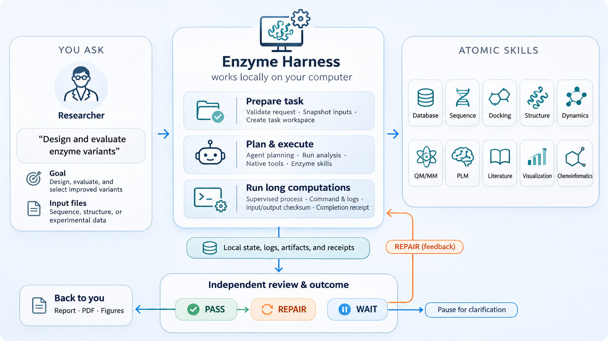
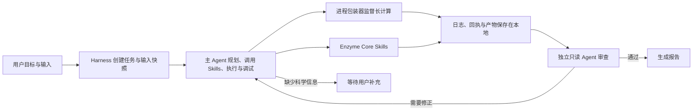
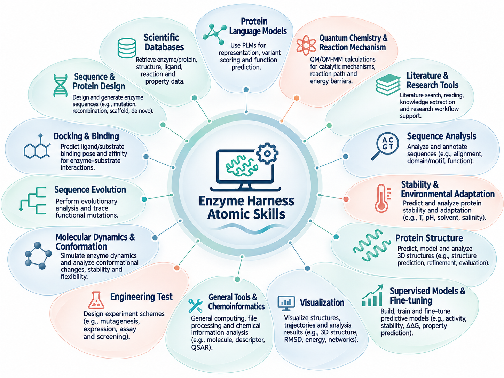

[English](README.md) | 简体中文

# Enzyme Core and Harness

**面向酶与蛋白质研究的本地可组合 Skill 工具箱，以及可切换 Agent（Codex CLI 或 DeepSeek Harness）的长任务执行框架。**

Enzyme Core 将常用的科学工作流整理为可发现、可说明、可检查、可执行的原子 Skills；Enzyme Harness 在外层负责接收任务、创建本地工作区、监督长计算、保存执行证据、恢复中断任务、独立审查结果并生成报告。Agent 可按 `setup` 或单个任务选择：Codex CLI 运行 GPT 系列模型，DeepSeek Harness（`dsh`）运行 DeepSeek 模型并支持自定义 provider 路由。研究者可以直接调用单个 Skill，也可以把简短的自然语言目标交给 Agent 规划和执行多步任务。

> Skill 登记表示项目提供了相应的工作流说明或执行入口，不代表相关软件、模型权重、数据库、GPU、凭据或科学输入已经安装，也不代表结果已通过科学验证。

## 项目一览

- **95 个目录化 Skills**，覆盖序列、结构、蛋白质语言模型、设计、对接、动力学、量子化学、化学信息、数据库、研究支持和可视化等领域。
- **202 个已生成的操作接口**，为可执行操作提供参数、输入/输出和依赖信息，便于查看和进行运行前检查。
- **两个 Python 包**：`enzyme-core` 提供 Skill 能力；`enzyme-harness` 提供 Codex CLI 或 `dsh` 的任务运行和本地监督。
- **可切换 Agent 运行时**：Codex CLI（GPT 系列模型）或 DeepSeek Harness（`dsh`，DeepSeek 及可配置 provider 路由），可全局或按任务选择，共享同一套任务、审查和报告流程。
- **本地优先**：任务状态、输入快照、命令记录、进程回执和结果保存在用户指定的本地任务目录。
- **按需配置**：轻量基础安装；模型、GPU、专有软件、外部服务和数据库依赖按 Skill 单独准备。

## 工作流架构



一次典型任务的过程如下：

1. 用户提交目标和输入文件，Harness 校验请求并将输入快照到任务工作区。
2. 主 Agent（Codex CLI 或 `dsh`）查看请求、输入和相关 Skill，自主制定步骤，调用 Skill，执行分析并调试。
3. 长时间运行的科学命令可由本地进程包装器监督，记录命令、进程身份、日志、资源信息、退出状态和产物摘要。
4. 新的只读 Agent 会话独立检查请求、运行证据、产物与结论。
5. 审查通过后生成本地报告；需要修正时，审查发现返回主会话处理；需要科学信息时，任务等待用户补充。
6. `resume` 在恢复前核对 Agent 会话、受管进程和回执，避免对状态不明的计算自动重复运行。



### 两层职责

| 部件 | 负责什么 | 不代表什么 |
|---|---|---|
| **Enzyme Core** | Skill 发现与说明、依赖检查、执行准备、调用本地 Python/可执行程序、声明产物检查 | 不替用户选择研究问题，不会自动安装所有模型，也不单独保证科学结论正确 |
| **Enzyme Harness** | 可切换的 Codex CLI 或 `dsh` 主会话、任务目录与输入快照、后台进程监督、状态恢复、独立只读审查、本地报告 | 不是云端任务服务或实验室数据库；Harness `PASS` 不能替代实验验证 |
| **Skill** | 某一类科学方法或工具的说明、接口与局部工作流 | Skill 可被发现不等于它的外部依赖或数据当前可用 |

## Skill 功能地图



下表按 Skill 目录类别汇总 95 个目录项。`repair-validation` 是工程修复验证用的测试 Skill；其余 94 项构成常规科学与研究支持目录。展开各类别可查看 Skill 简介并直接打开对应的 `SKILL.md`。

| 类别 | 数量 | 覆盖能力 | 示例 |
|---|---:|---|---|
| `data` | 31 | 查询与整理蛋白质、序列、结构、化合物、通路、基因组及生物医学数据库。 | `brenda-database`, `chembl-database`, `clinical-trials-database` |
| `design` | 6 | 开展序列/结构设计、蛋白质生成、PyRosetta 设计和综合理性设计。 | `ligandmpnn`, `proteinmpnn`, `pyrosetta-pack-design` |
| `docking` | 4 | 分析酶与配体的对接、结合模式、亲和力和选择性。 | `binding-affinity`, `pyrosetta-docking`, `pyrosetta-ligand` |
| `evolution` | 2 | 利用进化信息和突变数据分析序列变化与功能适应。 | `gemme`, `rational-expression-evolution` |
| `md` | 2 | 运行分子动力学并研究构象、转运和动态行为。 | `openmm-md`, `rational-transport-dynamics` |
| `plm` | 3 | 使用蛋白质语言模型进行序列表示、零样本打分和结构条件评分。 | `esm`, `esmif`, `saprot` |
| `qmmm` | 2 | 研究酶催化反应、量子化学和反应机理相关问题。 | `enzyme-qm-ts`, `rational-chemical-mechanism` |
| `research` | 11 | 支持文献检索、证据整理、假设形成、批判性分析和同行评审。 | `hypothesis-generation`, `literature-protein-collector`, `literature-review` |
| `sequence` | 4 | 获取、比对、搜索并注释蛋白质及核酸序列。 | `glycobiology`, `ncbi-sequence-fetch`, `protein-sequence-msa` |
| `stability` | 2 | 评估结构打分、稳定性因素和环境适应性。 | `pyrosetta-scoring`, `rational-stability-environment` |
| `structure` | 8 | 进行结构预测、结构搜索、结构修复和结构操作。 | `alphafold`, `alphafold-database-fetch-and-analyze`, `boltz` |
| `supervised-finetuning-models` | 2 | 构建监督模型训练和微调流程，并对候选变体进行评分。 | `mut-model-supervised-finetuning`, `venusfsfp-supervised-finetuning` |
| `testing` | 1 | 包含 Harness/Core 修复验证用测试 Skill，不属于常规科学分析能力。 | `repair-validation` |
| `utilities` | 7 | 提供化学信息学、报告生成、环境辅助和工作流工具。 | `html-report-renderer`, `markitdown`, `pyrosetta-parallel` |
| `visualization` | 10 | 绘制蛋白、分子、结构、数据和科学示意图。 | `dna-visualization`, `infographics`, `matplotlib` |

<details>
<summary><strong>展开完整 Skill 目录（95 项）</strong></summary>

<details>
<summary><strong>data</strong> — 31 Skill(s): 查询与整理蛋白质、序列、结构、化合物、通路、基因组及生物医学数据库。</summary>

| Skill | 功能简介 |
|---|---|
| [brenda-database](src/enzyme_core/skills/data/brenda-database/SKILL.md) | Access BRENDA enzyme database via SOAP API. Retrieve kinetic parameters (Km, kcat), reaction equations, organism data, and substrate-specific enzyme information for biochemical research and metabolic… |
| [chembl-database](src/enzyme_core/skills/data/chembl-database/SKILL.md) | Query the ChEMBL database for bioactive molecules, drug targets, bioactivity data, approved drugs, and chemical structures. Use when the user asks about compounds, targets, IC50/Ki values, drug mechanisms… |
| [clinical-trials-database](src/enzyme_core/skills/data/clinical-trials-database/SKILL.md) | Query ClinicalTrials.gov via APIv2. Use when you want to search for trials by condition, drug, location, status, or phase; retrieve trial details by NCT ID; check eligibility/inclusion criteria; count… |
| [clinvar-database](src/enzyme_core/skills/data/clinvar-database/SKILL.md) | Use when needing clinical significance, pathogenicity classifications (e.g., Pathogenic, Benign, VUS), clinical evidence rationales, or finding "hard positive" benchmark controls for human genomic variants. |
| [dbsnp-database](src/enzyme_core/skills/data/dbsnp-database/SKILL.md) | Use when you want to look up, map, and search for short genetic variants (SNPs, indels) in NCBI's dbSNP database. Resolves between rsIDs, genomic coordinates in VCF format, and HGVS strings. For an rsID… |
| [embl-ebi-ols](src/enzyme_core/skills/data/embl-ebi-ols/SKILL.md) | Query and search the EMBL-EBI Ontology Lookup Service (OLS) for biomedical ontology terms, definitions, and hierarchies across 250+ ontologies (e.g., GO, DOID, HP). Use when the user asks to search for… |
| [ena-database](src/enzyme_core/skills/data/ena-database/SKILL.md) | Access European Nucleotide Archive via API/FTP. Retrieve DNA/RNA sequences, raw reads (FASTQ), genome assemblies by accession, for genomics and bioinformatics pipelines. Supports multiple formats. |
| [encode-ccres-database](src/enzyme_core/skills/data/encode-ccres-database/SKILL.md) | Query the ENCODE Registry of cis-Regulatory Elements (cCREs) via the SCREEN GraphQL API, or make custom queries to the ENCODE Portal REST API for experiments and files (ChIP-seq peaks, etc.). Use when you… |
| [ensembl-database](src/enzyme_core/skills/data/ensembl-database/SKILL.md) | Query the Ensembl database to resolve gene, transcript, and protein IDs, fetch genomic or protein sequences, retrieve gene structures (exons), and get variant consequence and effect predictions (VEP). Use… |
| [gene-database](src/enzyme_core/skills/data/gene-database/SKILL.md) | Query NCBI Gene via E-utilities/Datasets API. Search by symbol/ID, retrieve gene info (RefSeqs, GO, locations, phenotypes), batch lookups, for gene annotation and functional analysis. |
| [gnomad-database](src/enzyme_core/skills/data/gnomad-database/SKILL.md) | Query the Genome Aggregation Database (gnomAD). Use when determining the rarity or allele frequency of specific genetic variants, retrieving gene constraint metrics (pLI, LOEUF) to assess loss-of-function… |
| [gtex-database](src/enzyme_core/skills/data/gtex-database/SKILL.md) | Use when you want to retrieve quantitative RNA expression data and variant eQTL information from the GTEx (Genotype-Tissue Expression) Project across 54 non-diseased tissue sites. |
| [hmdb-database](src/enzyme_core/skills/data/hmdb-database/SKILL.md) | Access Human Metabolome Database (220K+ metabolites). Search by name/ID/structure, retrieve chemical properties, biomarker data, NMR/MS spectra, pathways, for metabolomics and identification. |
| [human-protein-atlas-database](src/enzyme_core/skills/data/human-protein-atlas-database/SKILL.md) | Use when you want to retrieve semi-quantitative protein expression and spatial localisation data from the Human Protein Atlas (HPA). |
| [interpro-database](src/enzyme_core/skills/data/interpro-database/SKILL.md) | Identify domains, families, and sites in proteins; find all proteins in a family or sharing a domain; explore species distribution for a domain; annotate genomes with protein families and GO terms. InterPro… |
| [jaspar-database](src/enzyme_core/skills/data/jaspar-database/SKILL.md) | Query the JASPAR database for Transcription Factor (TF) binding profiles. Use when retrieving Position Frequency Matrices (PFMs) or Position Weight Matrices (PWMs) for specific TFs, resolving gene symbols… |
| [kegg-database](src/enzyme_core/skills/data/kegg-database/SKILL.md) | Direct REST API access to KEGG (academic use only). Pathway analysis, gene-pathway mapping, metabolic pathways, drug interactions, ID conversion. For Python workflows with multiple databases, prefer… |
| [openfda-database](src/enzyme_core/skills/data/openfda-database/SKILL.md) | Query, search, and download data from the openFDA API for drugs, devices, foods, tobacco, cosmetics, animal and veterinary products, substances, and transparency data. Use for FDA adverse events, recalls… |
| [opentargets-database](src/enzyme_core/skills/data/opentargets-database/SKILL.md) | Query Open Targets Platform for target-disease associations, drug target discovery, tractability/safety data, genetics/omics evidence, known drugs, for therapeutic target identification. |
| [pdb](src/enzyme_core/skills/data/pdb/SKILL.md) | Fetch and analyze protein structures from RCSB PDB. Use this skill when: (1) Need to download a structure by PDB ID, (2) Search for similar structures, (3) Prepare target for binder design, (4) Extract… |
| [pdb-database](src/enzyme_core/skills/data/pdb-database/SKILL.md) | Use when you want to search for or download experimentally-determined 3D structures for biomolecules (proteins, nucleic acids, bound ligands). Supports searching by sequence similarity, structure… |
| [pubchem-database](src/enzyme_core/skills/data/pubchem-database/SKILL.md) | Query PubChem, search by name/CID/SMILES, retrieve properties, similarity/substructure searches, bioactivity, for cheminformatics. Use when a user asks about a specific chemical, drug, or molecule. |
| [public-data-inputs](src/enzyme_core/skills/data/public-data-inputs/SKILL.md) | Retrieve public input files and inspect protein structure identity for task input completion. |
| [pubmed-database](src/enzyme_core/skills/data/pubmed-database/SKILL.md) | Search PubMed for scientific literature, including published clinical trials. Fetch abstracts and full text. Link published research to biological databases (gene, protein, nucleotide, PubChem) to discover… |
| [quickgo-database](src/enzyme_core/skills/data/quickgo-database/SKILL.md) | Query the QuickGO and Evidence & Conclusion Ontology (ECO) REST API. Use this when you need to map genes to biological processes, molecular functions, or cellular components, find genes associated with a… |
| [reactome-database](src/enzyme_core/skills/data/reactome-database/SKILL.md) | Query the Reactome database (Analysis and Content Services). Use when the user asks about pathway analysis, gene list enrichment, retrieving results by token, finding unmapped or not-found identifiers… |
| [string-database](src/enzyme_core/skills/data/string-database/SKILL.md) | Query the STRING database for protein-protein interactions (PPIs), functional enrichment, and homology. Use when the user asks about interactions between specific proteins, interaction evidence, confidence… |
| [ucsc-conservation-and-tfbs](src/enzyme_core/skills/data/ucsc-conservation-and-tfbs/SKILL.md) | Fetch Evolutionary Conservation scores (phyloP, phastCons) and Transcription Factor Binding Sites (TFBS) from the UCSC Genome Browser. Use when analyzing whether genomic variants or regions are… |
| [unibind-database](src/enzyme_core/skills/data/unibind-database/SKILL.md) | Queries the UniBind database for experimentally validated transcription factor (TF) binding sites. Use when retrieving direct TF-DNA interaction datasets, downloading binding site coordinates (BED/FASTA)… |
| [uniprot](src/enzyme_core/skills/data/uniprot/SKILL.md) | Access UniProt for protein sequence and annotation retrieval. Use this skill when: (1) Looking up protein sequences by accession, (2) Finding functional annotations, (3) Getting domain boundaries, (4)… |
| [uniprot-database](src/enzyme_core/skills/data/uniprot-database/SKILL.md) | Access protein metadata, function, taxonomy, and sequences across UniProtKB, UniParc, and UniRef. Use when searching for proteins, mapping identifiers, or retrieving functional annotations and publications… |

</details>

<details>
<summary><strong>design</strong> — 6 Skill(s): 开展序列/结构设计、蛋白质生成、PyRosetta 设计和综合理性设计。</summary>

| Skill | 功能简介 |
|---|---|
| [ligandmpnn](src/enzyme_core/skills/design/ligandmpnn/SKILL.md) | Ligand-aware protein sequence design using LigandMPNN. Use this skill when: (1) Designing sequences around small molecules, (2) Enzyme active site design, (3) Ligand binding pocket optimization, (4) Metal… |
| [proteinmpnn](src/enzyme_core/skills/design/proteinmpnn/SKILL.md) | Design protein sequences using ProteinMPNN inverse folding. Use this skill when: (1) Designing sequences for RFdiffusion backbones, (2) Redesigning existing protein sequences, (3) Fixing specific residues… |
| [pyrosetta-pack-design](src/enzyme_core/skills/design/pyrosetta-pack-design/SKILL.md) | Use PyRosetta packing and design workflows, including repacking, point mutation scans, resfile-guided design, and score-based mutation ranking. Use this skill for Rosetta sequence design around fixed or… |
| [pyrosetta-specialized](src/enzyme_core/skills/design/pyrosetta-specialized/SKILL.md) | Guide specialized PyRosetta workflows from the notebooks: symmetry, electron density, antibodies, carbohydrates, RNA, and membrane proteins. Use this skill when a task depends on one of these specialized… |
| [rational-design-advanced](src/enzyme_core/skills/design/rational-design-advanced/SKILL.md) | Mechanism-driven rational-design planning, candidate explanation, and multi-method arbitration after enzyme-design candidates exist. Use to decide whether physical-chemistry review is warranted; present… |
| [solublempnn](src/enzyme_core/skills/design/solublempnn/SKILL.md) | Solubility-optimized protein sequence design using SolubleMPNN. Use this skill when: (1) Designing for E. coli expression, (2) Optimizing solubility of designed proteins, (3) Reducing aggregation… |

</details>

<details>
<summary><strong>docking</strong> — 4 Skill(s): 分析酶与配体的对接、结合模式、亲和力和选择性。</summary>

| Skill | 功能简介 |
|---|---|
| [binding-affinity](src/enzyme_core/skills/docking/binding-affinity/SKILL.md) | Estimate protein-protein or protein-peptide complex binding energies with OpenMM. Use this skill when Codex needs to score a complex PDB, compare wild-type and mutant complexes, rank designed binders by… |
| [pyrosetta-docking](src/enzyme_core/skills/docking/pyrosetta-docking/SKILL.md) | Plan and run PyRosetta protein-protein docking and interface analysis workflows. Use this skill for docking setup, partners strings, interface metrics, decoy generation, and post-docking ranking. |
| [pyrosetta-ligand](src/enzyme_core/skills/docking/pyrosetta-ligand/SKILL.md) | Guide PyRosetta ligand workflows including ligand params, ligand pose setup, local/global ligand docking, and GALigandDock-style workflows. Use this skill for protein-small-molecule Rosetta modeling rather… |
| [rational-binding-selectivity](src/enzyme_core/skills/docking/rational-binding-selectivity/SKILL.md) | Diagnose rational enzyme pocket-binding, substrate-recognition, regioselectivity, and stereoselectivity hypotheses after candidates exist. Use through rational-design-advanced to explain or challenge… |

</details>

<details>
<summary><strong>evolution</strong> — 2 Skill(s): 利用进化信息和突变数据分析序列变化与功能适应。</summary>

| Skill | 功能简介 |
|---|---|
| [gemme](src/enzyme_core/skills/evolution/gemme/SKILL.md) | GEMME evolutionary zero-shot scoring for protein point mutants from an MSA. Use this skill only to rank missense mutants by GEMME fitness/evolutionary scores when a homologous multiple sequence alignment is… |
| [rational-expression-evolution](src/enzyme_core/skills/evolution/rational-expression-evolution/SKILL.md) | Diagnose rational enzyme expression, aggregation, consensus or ancestral sequence, oligomer-interface, and oxidative-integrity hypotheses. Use through rational-design-advanced after candidates exist and… |

</details>

<details>
<summary><strong>md</strong> — 2 Skill(s): 运行分子动力学并研究构象、转运和动态行为。</summary>

| Skill | 功能简介 |
|---|---|
| [openmm-md](src/enzyme_core/skills/md/openmm-md/SKILL.md) | Run local OpenMM molecular dynamics for protein-ligand complexes. Use this skill when preparing a PDB for MD, extracting a bound ligand to SDF, applying simple PDBFixer mutations, minimizing a… |
| [rational-transport-dynamics](src/enzyme_core/skills/md/rational-transport-dynamics/SKILL.md) | Diagnose rational enzyme tunnel, gate, flexibility, conformational-preorganization, and allosteric-network hypotheses. Use through rational-design-advanced when substrate access, product release, functional… |

</details>

<details>
<summary><strong>plm</strong> — 3 Skill(s): 使用蛋白质语言模型进行序列表示、零样本打分和结构条件评分。</summary>

| Skill | 功能简介 |
|---|---|
| [esm](src/enzyme_core/skills/plm/esm/SKILL.md) | ESM-2 sequence-only zero-shot scoring for protein point mutants. Use this skill only to rank protein mutants by masked-marginal log probability ratio relative to the wild-type sequence. Do not use it for… |
| [esmif](src/enzyme_core/skills/plm/esmif/SKILL.md) | ESM-IF1 structure-conditioned zero-shot scoring for protein point mutants. Use this skill only to rank protein mutants by conditional log-likelihood difference relative to the wild-type sequence for a fixed… |
| [saprot](src/enzyme_core/skills/plm/saprot/SKILL.md) | SaProt structure-aware zero-shot scoring for protein point mutants. Use this skill only to rank protein mutants by amino-acid plus Foldseek 3Di context-aware log probability ratio relative to the wild-type… |

</details>

<details>
<summary><strong>qmmm</strong> — 2 Skill(s): 研究酶催化反应、量子化学和反应机理相关问题。</summary>

| Skill | 功能简介 |
|---|---|
| [enzyme-qm-ts](src/enzyme_core/skills/qmmm/enzyme-qm-ts/SKILL.md) | Run CP2K cluster or QM/MM reaction-path and transition-state workflows for enzyme and small-molecule mechanisms. Use for QM barriers, transition-state searches, NEB or dimer refinement, proton-transfer and… |
| [rational-chemical-mechanism](src/enzyme_core/skills/qmmm/rational-chemical-mechanism/SKILL.md) | Diagnose enzyme chemical-step hypotheses for low activity, proton or hydrogen transfer, transition-state stabilization, and metal/cofactor chemistry. Use through rational-design-advanced when reaction… |

</details>

<details>
<summary><strong>research</strong> — 11 Skill(s): 支持文献检索、证据整理、假设形成、批判性分析和同行评审。</summary>

| Skill | 功能简介 |
|---|---|
| [hypothesis-generation](src/enzyme_core/skills/research/hypothesis-generation/SKILL.md) | Generate testable hypotheses. Formulate from observations, design experiments, explore competing explanations, develop predictions, propose mechanisms, for scientific inquiry across domains. |
| [literature-protein-collector](src/enzyme_core/skills/research/literature-protein-collector/SKILL.md) | Search multiple scholarly sources for a named target protein and sequence, fetch only lawful open-access content, support evidence-bounded agent reading, extract reported mutants and assay results, map… |
| [literature-review](src/enzyme_core/skills/research/literature-review/SKILL.md) | Conduct comprehensive, systematic literature reviews using multiple academic databases (PubMed, arXiv, bioRxiv, Semantic Scholar, etc.). This skill should be used when conducting systematic literature… |
| [literature-search-arxiv](src/enzyme_core/skills/research/literature-search-arxiv/SKILL.md) | Search for scientific papers, preprints, and publications on arXiv. Extract metadata, abstracts, and download full-text PDFs or HTML versions of papers. Use when the user asks to find research papers… |
| [literature-search-biorxiv](src/enzyme_core/skills/research/literature-search-biorxiv/SKILL.md) | Browse, filter, and download life sciences, biology, and medical preprints from bioRxiv and medRxiv. Supports fetching paper metadata by DOI, and browsing by date range with category and keyword filters… |
| [literature-search-europepmc](src/enzyme_core/skills/research/literature-search-europepmc/SKILL.md) | Search Europe PMC for scientific literature and download open-access full texts and PDFs. Retrieve full-text XML/plain text by PMCID, get citation lists and bibliography. |
| [literature-search-openalex](src/enzyme_core/skills/research/literature-search-openalex/SKILL.md) | Query the OpenAlex scholarly database for research papers, authors, institutions, topics, sources, publishers, funders, geo-locations, and keywords. Use when searching academic papers, resolving DOIs… |
| [peer-review](src/enzyme_core/skills/research/peer-review/SKILL.md) | Systematic peer review toolkit. Evaluate methodology, statistics, design, reproducibility, ethics, figure integrity, reporting standards, for manuscript and grant review across disciplines. |
| [scholar-evaluation](src/enzyme_core/skills/research/scholar-evaluation/SKILL.md) | Evaluate scholarly papers, proposals, literature reviews, and research methods with structured quality dimensions, scoring rubrics, and actionable feedback. |
| [scientific-brainstorming](src/enzyme_core/skills/research/scientific-brainstorming/SKILL.md) | Creative research ideation and exploration. Use for open-ended brainstorming sessions, exploring interdisciplinary connections, challenging assumptions, or identifying research gaps. Best for early-stage… |
| [scientific-critical-thinking](src/enzyme_core/skills/research/scientific-critical-thinking/SKILL.md) | Evaluate research rigor. Assess methodology, experimental design, statistical validity, biases, confounding, evidence quality (GRADE, Cochrane ROB), for critical analysis of scientific claims. |

</details>

<details>
<summary><strong>sequence</strong> — 4 Skill(s): 获取、比对、搜索并注释蛋白质及核酸序列。</summary>

| Skill | 功能简介 |
|---|---|
| [glycobiology](src/enzyme_core/skills/sequence/glycobiology/SKILL.md) | Glycosylation site prediction and glycobiology analysis. N-glycosylation motif finding, O-glycosylation hotspot prediction, glycan structure resources. Lightweight, pure Python. For protein function queries… |
| [ncbi-sequence-fetch](src/enzyme_core/skills/sequence/ncbi-sequence-fetch/SKILL.md) | Retrieve protein and nucleotide sequences from NCBI databases using E-utilities. Supports direct accession lookup, CDS translation, gene+organism search, locus lookup, PubMed-linked sequences, patent… |
| [protein-sequence-msa](src/enzyme_core/skills/sequence/protein-sequence-msa/SKILL.md) | Prepares protein multiple sequence alignments for conservation analysis and MSA-consuming models. Prefer high-quality ColabFold/Boltz-style MMseqs2 A3M output when homolog search is needed, and use EBI… |
| [protein-sequence-similarity-search](src/enzyme_core/skills/sequence/protein-sequence-similarity-search/SKILL.md) | Searches for homologous protein sequences using MMseqs2 (fast, default) or BLAST (comprehensive, fallback). Trigger this whenever the user provides a protein sequence or FASTA file and asks to find… |

</details>

<details>
<summary><strong>stability</strong> — 2 Skill(s): 评估结构打分、稳定性因素和环境适应性。</summary>

| Skill | 功能简介 |
|---|---|
| [pyrosetta-scoring](src/enzyme_core/skills/stability/pyrosetta-scoring/SKILL.md) | Score protein structures with PyRosetta score functions and compute energy or interface metrics. Use this skill for ref2015 scoring, residue/complex assessment, score tables, and PyRosetta interface… |
| [rational-stability-environment](src/enzyme_core/skills/stability/rational-stability-environment/SKILL.md) | Diagnose rational enzyme thermostability, pH tolerance, hydration, solvent tolerance, and surface-electrostatic hypotheses. Use through rational-design-advanced to attach condition-specific physical… |

</details>

<details>
<summary><strong>structure</strong> — 8 Skill(s): 进行结构预测、结构搜索、结构修复和结构操作。</summary>

| Skill | 功能简介 |
|---|---|
| [alphafold](src/enzyme_core/skills/structure/alphafold/SKILL.md) | Validate protein designs using AlphaFold2 structure prediction. Use this skill when: (1) Validating designed sequences fold correctly, (2) Predicting binder-target complex structures, (3) Calculating… |
| [alphafold-database-fetch-and-analyze](src/enzyme_core/skills/structure/alphafold-database-fetch-and-analyze/SKILL.md) | Retrieve and analyze AlphaFold predicted structures for a protein. Use when the user provides a specific UniProt Accession ID and wants structural confidence metrics (pLDDT), domain boundary analysis, or… |
| [boltz](src/enzyme_core/skills/structure/boltz/SKILL.md) | Structure prediction using the locally registered Boltz-2 installation. Use this skill when: (1) Predicting protein complex structures, (2) Validating designed binders, (3) Need open-source alternative to… |
| [foldseek](src/enzyme_core/skills/structure/foldseek/SKILL.md) | Structure similarity search with Foldseek. Use this skill when: (1) Finding similar structures in PDB/AFDB databases, (2) Structural homology search, (3) Database queries by 3D structure, (4) Finding remote… |
| [foldseek-structural-search](src/enzyme_core/skills/structure/foldseek-structural-search/SKILL.md) | Performs 3D structural searches of proteins against various databases (PDB, AlphaFold, CATH, MGnify, etc.) using the Foldseek API. Use ONLY when the user provides a physical 3D coordinate file (.cif… |
| [pyrosetta-loops](src/enzyme_core/skills/structure/pyrosetta-loops/SKILL.md) | Plan PyRosetta loop modeling and loop refinement workflows, including loop selection, loop files, GenKIC-style modeling, and post-loop relaxation/scoring. |
| [pyrosetta-pose](src/enzyme_core/skills/structure/pyrosetta-pose/SKILL.md) | Work with PyRosetta Pose objects, PDB loading, chain/residue inspection, coordinate access, geometry, aligned backbone RMSD, CA RMSD, and basic structure cleanup. Use this skill when preparing structures… |
| [pyrosetta-relax-refine](src/enzyme_core/skills/structure/pyrosetta-relax-refine/SKILL.md) | Refine protein structures with PyRosetta FastRelax, minimization, and related Rosetta refinement workflows. Use this skill for structure relaxation, local minimization, decoy generation, and pre-scoring… |

</details>

<details>
<summary><strong>supervised-finetuning-models</strong> — 2 Skill(s): 构建监督模型训练和微调流程，并对候选变体进行评分。</summary>

| Skill | 功能简介 |
|---|---|
| [mut-model-supervised-finetuning](src/enzyme_core/skills/supervised-finetuning-models/mut-model-supervised-finetuning/SKILL.md) | Supervised fine-tuning model skill for the local mut_model JAX/Flax protein mutation predictor. Always build pseudo-labeled mutant data and complete pseudo-label pretraining before fine-tuning on real… |
| [venusfsfp-supervised-finetuning](src/enzyme_core/skills/supervised-finetuning-models/venusfsfp-supervised-finetuning/SKILL.md) | Supervised protein fitness fine-tuning via VenusFSFP. Always use large pseudo-labeled mutation libraries (single-site saturation + random multi-site) scored by a zero-shot model (SaProt or GEMME) for meta… |

</details>

<details>
<summary><strong>testing</strong> — 1 Skill(s): 包含 Harness/Core 修复验证用测试 Skill，不属于常规科学分析能力。</summary>

| Skill | 功能简介 |
|---|---|
| [repair-validation](src/enzyme_core/skills/testing/repair-validation/SKILL.md) | Engineering-only isolated repair acceptance fixture. Normalize a CSV molecule table without changing scientific values. Not a scientific method. |

</details>

<details>
<summary><strong>utilities</strong> — 7 Skill(s): 提供化学信息学、报告生成、环境辅助和工作流工具。</summary>

| Skill | 功能简介 |
|---|---|
| [html-report-renderer](src/enzyme_core/skills/utilities/html-report-renderer/SKILL.md) | Polish, render, or review any human-readable HTML report generated by this enzyme mutation design project. Use whenever a workflow, skill, script, or intermediate processing step needs to create a .html… |
| [markitdown](src/enzyme_core/skills/utilities/markitdown/SKILL.md) | Convert files and office documents to Markdown. Supports PDF, DOCX, PPTX, XLSX, images (with OCR), audio (with transcription), HTML, CSV, JSON, XML, ZIP, YouTube URLs, EPubs and more. |
| [pyrosetta-parallel](src/enzyme_core/skills/utilities/pyrosetta-parallel/SKILL.md) | Run or plan parallel PyRosetta workflows with many decoys or mutations. Use this skill for GNU parallel, dask, PyRosettaCluster-style batching, and local batch execution of scoring, relax, docking, or… |
| [pyrosetta-setup](src/enzyme_core/skills/utilities/pyrosetta-setup/SKILL.md) | Set up and troubleshoot PyRosetta for OpenCode protein modeling workflows. Use this skill when PyRosetta is missing, licensing or wheel installation is unclear, initialization fails, or a user needs a… |
| [rdkit](src/enzyme_core/skills/utilities/rdkit/SKILL.md) | Cheminformatics toolkit for fine-grained molecular control. SMILES/SDF parsing, descriptors (MW, LogP, TPSA), fingerprints, substructure search, 2D/3D generation, similarity, reactions. For standard… |
| [uv](src/enzyme_core/skills/utilities/uv/SKILL.md) | Checks whether the uv Python package manager is installed and installs it if missing. Ensures uv is on PATH. Use when another skill requires uv as a prerequisite. |
| [workflow-skill-creator](src/enzyme_core/skills/utilities/workflow-skill-creator/SKILL.md) | Distills a completed user workflow or interaction into a reusable agent skill. Use when the user asks to turn their workflow, interaction, or multi-step process into a skill, or when they say "make this a… |

</details>

<details>
<summary><strong>visualization</strong> — 10 Skill(s): 绘制蛋白、分子、结构、数据和科学示意图。</summary>

| Skill | 功能简介 |
|---|---|
| [dna-visualization](src/enzyme_core/skills/visualization/dna-visualization/SKILL.md) | Publication-quality DNA/RNA visualizations. Plasmid maps (circular/linear), sequence logos, restriction enzyme maps, GC content plots, and gene feature annotation tracks from GenBank/FASTA. |
| [infographics](src/enzyme_core/skills/visualization/infographics/SKILL.md) | [EXPERIMENTAL] Create professional infographics using Nano Banana Pro AI with smart iterative refinement. Uses Gemini 3 Pro for quality review. Integrates research-lookup and web search for accurate data… |
| [matplotlib](src/enzyme_core/skills/visualization/matplotlib/SKILL.md) | Low-level plotting library for full customization. Use when you need fine-grained control over every plot element, creating novel plot types, or integrating with specific scientific workflows. Export to… |
| [molecule-visualization](src/enzyme_core/skills/visualization/molecule-visualization/SKILL.md) | Publication-quality molecular visualization. 2D structure drawings (PNG/SVG), molecule grids with property annotations, scaffold highlighting, protein-ligand interaction diagrams, and interactive 3D views. |
| [plotly](src/enzyme_core/skills/visualization/plotly/SKILL.md) | Interactive visualization library. Use when you need hover info, zoom, pan, or web-embeddable charts. Best for dashboards, exploratory analysis, and presentations. For static publication figures use… |
| [protein-diagram](src/enzyme_core/skills/visualization/protein-diagram/SKILL.md) | Publication-quality protein analysis diagrams. Domain architecture maps, secondary structure annotation, Ramachandran plots, contact maps, multiple sequence alignment visualization, and protein feature tracks. |
| [pymol](src/enzyme_core/skills/visualization/pymol/SKILL.md) | Visualize, analyze, and render protein and molecular structures using PyMOL. Use when the user wants to create images of protein structures, perform structural alignments or superposition, measure distances… |
| [scientific-schematics](src/enzyme_core/skills/visualization/scientific-schematics/SKILL.md) | [EXPERIMENTAL] Create publication-quality scientific diagrams using Nano Banana Pro AI with smart iterative refinement. Uses Gemini 3 Pro for quality review. Only regenerates if quality is below threshold… |
| [scientific-visualization](src/enzyme_core/skills/visualization/scientific-visualization/SKILL.md) | Meta-skill for publication-ready figures. Use when creating journal submission figures requiring multi-panel layouts, significance annotations, error bars, colorblind-safe palettes, and specific journal… |
| [seaborn](src/enzyme_core/skills/visualization/seaborn/SKILL.md) | Statistical visualization with pandas integration. Use for quick exploration of distributions, relationships, and categorical comparisons with attractive defaults. Best for box plots, violin plots, pair… |

</details>

</details>

## 安装

### 环境要求

- Python 3.10 或更新版本。
- 使用 Harness 时需安装并登录一个 Agent：Codex CLI，或可访问模型路由的 DeepSeek Harness（`dsh`）。
- 使用 DeepSeek Harness 还需要 Node.js；模型密钥从启动环境（或 `--dsh-patch` 覆盖层）读取，不会写入任务状态。
- 推荐 Linux；部分科学工具依赖 Linux 原生程序、GPU 驱动或特定隔离能力。
- 每个 Skill 的依赖不同；模型权重、数据库、专有软件、API 凭据和远程服务不随包发布。

### 从源码安装

```bash
git clone <repository-url>
cd <repository-directory>
python -m venv .venv
source .venv/bin/activate       # Windows: .venv\Scripts\activate
python -m pip install --upgrade pip
python -m pip install -e .
python -m pip install -e ./harness
```

可选依赖组按需安装：

```bash
python -m pip install -e '.[retrieval,analysis,chemistry,documents]'
```

## 直接使用 Enzyme Core

```bash
# 搜索 Skill，并查看它的完整说明
enzyme-core discover structure
enzyme-core describe alphafold

# 检查 RDKit 操作当前是否具备可用依赖
enzyme-core doctor rdkit --operation molecular_properties

# 准备或执行一个已登记操作
enzyme-core prepare rdkit --operation molecular_properties -- CCO
enzyme-core run rdkit --operation molecular_properties --work-dir ./work/rdkit -- CCO
```

`prepare` 解析操作并生成准备结果；`run` 执行操作。Python API 位于 `enzyme_core.api`，包含 `discover`、`describe`、`doctor`、`prepare`、`execute` 和 `validate_delivery`。请先阅读目标 Skill 的说明，并根据 `doctor` 输出配置所需的程序、环境和数据。

## 使用 Enzyme Harness

创建一个 `request.json`：

```json
{
  "schema_version": "enzyme-harness/request/v1",
  "goal": "Compare enzyme variants using the supplied sequence and assay table.",
  "inputs": {
    "sequence": "/absolute/path/to/protein.fasta",
    "assay": "/absolute/path/to/measurements.csv"
  }
}
```

选择 Agent 与模型，然后提交并查看任务：

```bash
# Codex CLI + GPT 系列模型
enzyme-harness setup --agent codex --model gpt-6-luna

# DeepSeek Harness + DeepSeek 模型
enzyme-harness setup --agent dsh --model deepseek-flash --provider deepseek-official

enzyme-harness doctor
enzyme-harness task submit --request request.json
enzyme-harness task status TASK_ID
enzyme-harness task inspect TASK_ID
enzyme-harness task resume TASK_ID
enzyme-harness task report TASK_ID
```

`setup` 把默认选择写入本地 Harness 根目录；单个 `request.json` 可以覆盖 `agent`、`model`、`provider`。只切换 `agent` 而不指定模型时使用该 Agent 的默认模型。`doctor` 会报告两个 Agent 的安装与版本、以及本机是否真的能执行沙箱隔离。只有在主机没有可用 OS 沙箱时才使用 `--sandbox-backend none`：Agent 将以完整权限运行，只读审查退化为提示词约束并由控制器核对产物摘要，报告会记录 `unconfined_calls`。隔离模型与 dsh 凭据配置见 [Harness 用户指南](harness/README.md)。

Harness 将请求输入快照、Agent 事件、受管进程回执、结果、审查意见和报告放在本地任务目录；默认根目录是 `~/.local/share/enzyme-harness`，位于本仓库之外。长时间计算可从任务工作区使用 `enzyme-harness process run` 启动，以便记录实际命令、输入摘要、进程身份、日志、退出状态、资源采样及声明产物摘要。相同 ID 与相同调用会复用已有运行；相同 ID 的不同调用会报冲突。

## 资源与环境配置

基础安装保持轻量。可在 [`src/enzyme_core/runtime/resources.json`](src/enzyme_core/runtime/resources.json) 查看可选模型和程序资源声明；机器专属配置示例位于 [`resources.local.example.json`](src/enzyme_core/runtime/resources.local.example.json)。复制示例后按本机路径设置 `ENZYME_CORE_RESOURCES_LOCAL`；需要完整替换时使用 `ENZYME_CORE_RESOURCES`。凭据应放在环境变量或密钥管理器中，不要提交到仓库。

### 随包源码

`src/enzyme_core/vendor/` 随包提供 LigandMPNN/ProteinMPNN/SolubleMPNN 与 mut_model Skill 在本地执行的源码，因此仅发布本仓库目录即可获得这些 Skill 需要的代码路径。仅打包源码：模型权重、数据集、Docker 镜像和外部工具仍由用户通过 `resources.json` 或 `resources.local.json` 配置。各目录保留上游许可证与署名，`THIRD_PARTY_NOTICES.md` 同步记录；VenusFSFP 因其本地副本采用 CC BY-NC-ND 4.0 许可而未随包提供。

各 Skill 的依赖和运行方式以其 `SKILL.md` 为准。即使依赖检查通过，也要单独确认输入、参数、模型/数据库版本和科学证据满足研究问题。

## 设计原则与适用边界

- **原子 Skill，可组合调用**：使用者可直接调用一个工具，也可由 Agent 根据任务组合多个 Skill。
- **本地证据可追溯**：任务输入、执行记录、产物和审查材料保存在本地目录，便于复核与恢复。
- **状态事实和科学判断分开**：进程成功、产物有效、方法适用和科学结论是不同问题，报告应分别说明。
- **保留方法边界**：不因工具可用就推断实验活性、因果机制或预测能力；结论强度应由适当证据支持。
- **外部资源由使用者配置**：不打包模型权重、私人数据、受许可限制的软件或运行结果。

任务目录可能包含未发表序列、实验数据、提示词、命令和 Agent 会话内容。请在分享任务目录或提交 GitHub 前检查文件；`.gitignore` 已排除常见模型、运行输出、密钥和构建产物，但仍应检查 `git status`。

## 开发与验证

```bash
python -m pip install -e '.[retrieval,analysis]'
python -m pip install -e ./harness
python scripts/check_core.py
python -m unittest discover -s tests -v
```

更多细节见 [架构说明](ARCHITECTURE.md)、[Harness 用户指南](harness/README.md)、[Harness 实现说明](harness/IMPLEMENTATION.md)、[许可证](LICENSE) 和 [第三方归属说明](THIRD_PARTY_NOTICES.md)。

## 许可

项目原创内容按 Apache-2.0 许可发布；目录中部分 Skills 基于其他上游项目修改，适用各自许可证和署名要求。逐 Skill 来源、修订版本及许可信息见 [`skill_provenance.json`](src/enzyme_core/skill_provenance.json) 和 [`THIRD_PARTY_NOTICES.md`](THIRD_PARTY_NOTICES.md)。外部软件、权重、数据库和服务不因本项目提供 Skill 而改变其许可条款。
